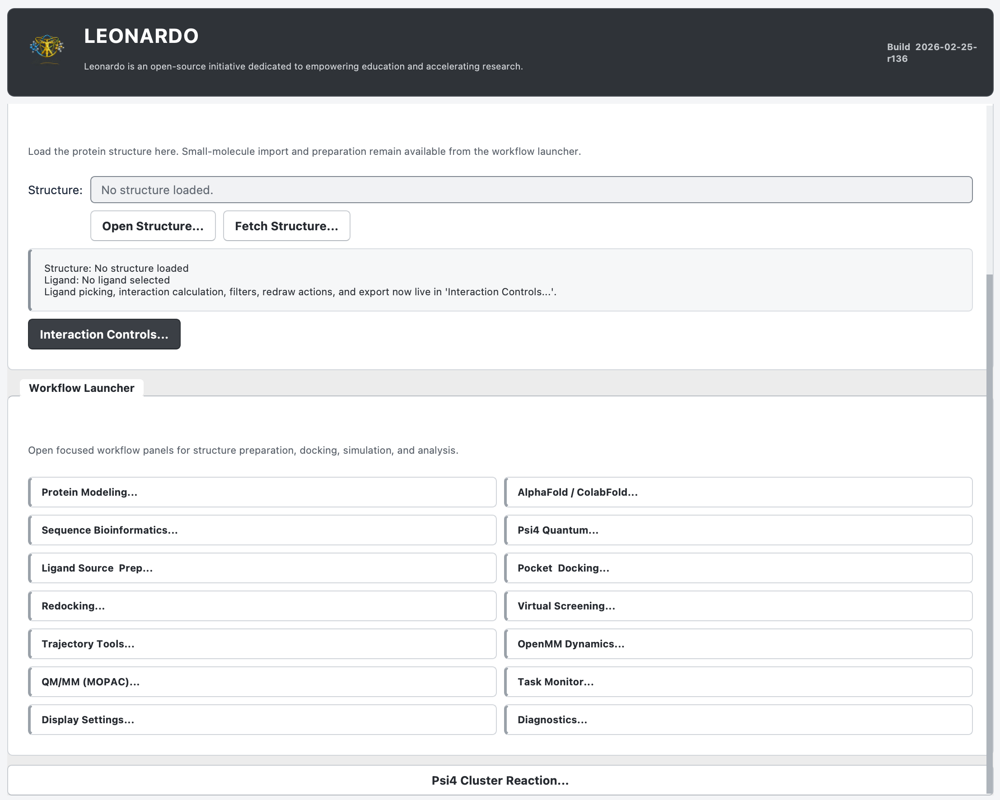

# Leonardo

<p align="center">
  
</p>

Leonardo is a PyMOL-based molecular modeling and simulation suite for structure analysis, docking, redocking, ligand preparation, quantum chemistry, molecular dynamics, MOPAC/Psi4 reaction-path workflows, optional QM/MM helper routines, protein modeling, and sequence-guided simulation planning.

Author: Juvenal Yosa, PhD  
Contact: jyosa@protyon.tech
Technical support and bug reports: thinkai.col@gmail.com

## Pre-release and Manuscript Verification Status

This source tree is a manuscript-verification pre-release of Leonardo (`0.2.0a5`, build `2026-07-08-r5`), not a final stable production release.

It is being shared so users can:

- test the workflows on real projects
- detect bugs and reproducibility problems
- help prioritize the next round of fixes and improvements

When reporting a bug, include as much detail as possible:

- Leonardo version or zip filename
- operating system
- active conda environment
- workflow used
- input files or file types
- exact error message
- steps to reproduce the problem

[](https://www.youtube.com/watch?v=ivQN7lLcBTU)

Compatibility note:
- The visible suite name is `Leonardo`.
- Some internal modules, folders, and environment names still use the legacy `ProtLigInteract` name for compatibility.
- Third-party engine licenses, optional restrictions and validated versions are
  summarized in `THIRD_PARTY_LICENSES.md`.

## Manuscript Verification Scope

The BMC Bioinformatics draft evaluates Leonardo primarily as a workflow and reproducibility layer. The current manuscript assets demonstrate object handling, backend dispatch, parsing, reporting, plotting, and selected guardrails on compact examples. They do not claim broad scientific benchmarks for every underlying method.

Current manuscript demonstrations include:

- 3PTB/benzamidine interaction analysis and single-target template redocking
- ligand-library quality control, not virtual-screening enrichment
- short ACE-ALA-NME OpenMM/CV diagnostic-grid plotting, not converged thermodynamic free energies
- guided-exit binding diagnostics from the historical ABFE-lite module, not quantitative absolute binding free energies
- Psi4/MOPAC mapped synchronous-transit guess and TS/IRC workflow examples, not general transition-state accuracy
- a synthetic MOPAC capped-cluster reaction path, not full protein-derived QM/MM validation

## Validation Status by Module

| Module | Current status | Manuscript evidence |
| --- | --- | --- |
| Interaction analysis | Workflow checked on compact crystal examples; not a curated all-class atom-pair benchmark | 3PTB/BEN contact report plus broad ProLIF count comparison |
| Pocket docking | Workflow checked for fpocket-to-smina handoff and reporting | fpocket pocket parsing, grid generation and smina output parsing |
| Redocking | Workflow checked for one template-redocking target | 1STP/biotin, 15 seeds, 225 pose rows |
| Ligand source and parametrization | QC and handoff checks; chemical correctness still depends on input protonation/tautomer state and external tools | 369 local SDF records parsed and summarized |
| Virtual screening and lead optimization | Available workflow modules; enrichment or prospective hit validation not claimed | Library QC only in manuscript |
| OpenMM dynamics | Setup, CV presets and diagnostic plotting checked; production convergence not claimed | ACE-ALA-NME CV traces and diagnostic-grid stability |
| Guided-exit binding diagnostic | Resource-bounded trajectory/state-gating diagnostic; not production ABFE, Kd, Ki or IC50 | 3PTB/BEN 5 ns guided-exit diagnostic with populated state gates |
| Psi4 and MOPAC reaction paths | Mapped synchronous-transit guess construction, engine handoff, frequency/IRC parsing and plotting checked | compact Psi4 and synthetic MOPAC reaction-path cases |
| Protein modeling, AlphaFold, sequence bioinformatics and task monitor | Adapter/workflow modules around external tools and services | parser, payload and UI/backend tests; not algorithm benchmarks |

## What Leonardo Is

Leonardo is not just an interaction viewer. It is a modular scientific workbench built around PyMOL as the main visual front end, with workflow modules for:

- protein-ligand and protein-nucleic-acid interaction analysis
- ligand sourcing, editing, charge derivation, and force-field preparation
- pocket detection and docking
- crystal-ligand redocking and WT vs mutant comparison
- virtual screening and hit-to-lead optimization
- trajectory analysis and local free-energy diagnostics
- OpenMM dynamics, sampling, and guided-exit diagnostic workflows
- MOPAC active-site-cluster/reaction workflows and optional OpenMM/MOPAC QM/MM helpers
- Psi4-based quantum chemistry workflows
- AlphaFold/ColabFold result generation and inspection
- sequence bioinformatics for simulation planning
- MODELLER-based protein repair and mutation modeling

The architecture is intentionally split between a PyMOL/Qt UI layer and runtime modules such as `dock_runtime.py`, `redock_runtime.py`, `vs_runtime.py`, `leadopt_runtime.py`, `abfe_runtime.py`, `alphafold_runtime.py`, `psi4_runtime.py`, `bioseq_runtime.py`, and others. The UI is still large, but the workflow logic is increasingly modular and testable.

## Main Capabilities

- Report candidate hydrogen bonds, halogen bonds, cation-pi, pi-pi, metal coordination, hydrophobic contacts, and van der Waals contact clusters using conservative rule-based typing. The manuscript demonstrates a subset of observed contact classes and does not claim a complete curated benchmark for every class.
- Search PubChem, upload ligands, edit ligands in 2D, rebuild them in 3D, derive charges, and export docking/OpenMM-ready files.
- Run `fpocket` for pocket discovery and `smina` for docking, including flexible sidechain docking and repeated docking for confidence estimates.
- Perform true redocking against a crystal ligand, calculate ligand RMSD to the reference pose, and compare WT vs mutant systems or MODELLER ensembles.
- Screen SDF libraries with RDKit/Meeko/smina and promote hits into lead optimization.
- Generate analogs from virtual-screening hits, filter them by medicinal chemistry rules, rank them by MPO, and optionally refine top compounds with OpenMM + PyMBAR.
- Run MD preparation and production workflows in OpenMM in gas phase, implicit solvent, or explicit solvent.
- Prepare and launch OpenMM workflows such as umbrella-style setup, metadynamics-style diagnostics, guided-exit binding diagnostics, and an OpenMM-ML wrapper path. Production convergence and free-energy uncertainty remain user responsibilities.
- Run MOPAC semiempirical capped-cluster reaction workflows and optional OpenMM/MOPAC QM/MM helper routines for probe, electrostatic, reaction-scan, and pose-rescoring experiments. The manuscript demonstrates a synthetic capped-cluster case, not a protein-derived enzymatic validation.
- Run Psi4 geometry optimization, frequencies, thermochemistry, TS search, IRC, mapped synchronous-transit guess reaction paths, electrostatic mapping, orbital visualization, and ESP-fit charge derivation.
- Import sequences from structures or RCSB, analyze motifs/disorder/TM/signal heuristics, compute local MSA conservation, and launch external sequence-analysis web tools.
- Build repaired or mutated proteins with MODELLER from observed chains or full sequences.

## Workflow Map

| Workflow | Main purpose | Main tools |
| --- | --- | --- |
| Interaction analysis | Detect and display noncovalent contacts in PyMOL | PyMOL, Biopython, NumPy |
| Display Settings | Control legends, labels, colors, export style | PyMOL, Qt |
| Project manager | Save and reopen complete Leonardo workspaces | JSON, PyMOL session save |
| Protein Modeling | Repair gaps, apply mutations, build models | MODELLER, Biopython |
| AlphaFold / ColabFold | Prepare local or Colab prediction runs and inspect results | ColabFold, matplotlib |
| Sequence Bioinformatics | Simulation-oriented sequence analysis | Biopython, BLAST, HMMER, Clustal Omega, MAFFT |
| Ligand Source & Prep | Source, edit, protonate, charge, parameterize, export ligands | RDKit, PubChem, Open Babel, AmberTools, Psi4 |
| Pocket Discovery & Docking | Detect pockets and dock ligands | fpocket, smina, Open Babel, optional AutoDockTools |
| Redocking | Redock crystal ligands and compare WT/mutant systems | smina, RDKit, optional MODELLER |
| Virtual Screening | Dock SDF libraries in batch | RDKit, Meeko, smina |
| Lead Optimization | Generate analogs and rank by MPO | RDKit, smina, optional OpenMM/PyMBAR |
| Trajectory Tools | Analyze trajectories and interaction persistence | PyMOL, OpenMM, MD-related runtimes |
| OpenMM Dynamics | Prepare and run MD workflows | OpenMM, AmberTools, OpenFF, PDBFixer |
| MOPAC reaction / QM-MM helpers | Active-site cluster reaction workflows and optional probe-guided QM/MM helpers | MOPAC, optional OpenMM |
| Psi4 Quantum | Standalone QM workflows and ESP charges | Psi4, qcelemental, QCElemental |
| Task Monitor | Observe long-running background jobs | Qt background workers |
| Diagnostics | Inspect workflow logs and runtime decisions | Qt log panel |

## Installation Overview

For the repository map and maintainability rules, see
[`docs/REPOSITORY_LAYOUT.md`](docs/REPOSITORY_LAYOUT.md). Root-level runtime
modules are intentional during the compatibility-preserving package migration.

Leonardo is easiest to install with the bundled conda environments. The recommended setup uses:

- `protliginteract-full`: required main environment that runs PyMOL and the core scientific stack
- `protliginteract-optional`: optional environment for heavier or conflict-prone extras such as ColabFold/JAX/DeepChem

This split is important. It keeps the PyMOL plugin stable while still allowing optional ML-heavy workflows.

### Supported installation strategy

1. Install Conda or Mamba.
2. Create the main environment from `environment.yml`.
3. Install the repository in editable mode for command-line tests.
4. Optionally create the extra environment from `environment-optional.yml`.
5. Build or use `dist/Leonardo.zip`.
6. Launch `pymol` from the main environment.
7. Install `dist/Leonardo.zip` into PyMOL's Plugin Manager.

### Minimum host expectations

- Qt-enabled PyMOL build
- Conda or Mamba available in the shell
- Enough disk space for conda environments, docking outputs, trajectories, and QM jobs
- CPU-only execution works for most workflows
- NVIDIA GPU is optional and mainly relevant for local ColabFold or accelerating some OpenMM workloads

## Install All Required Software

This is the most important section for end users publishing or installing Leonardo.

### macOS double-click install

For non-computational users on macOS, use the bundled double-click installer:

1. Open the Leonardo folder in Finder.
2. Double click `Install Leonardo.command`.
3. If Conda is not available, allow the installer to install Miniforge in `~/miniforge3`.
4. When installation finishes, double click `Launch Leonardo.command`.
5. In PyMOL, open `Plugins > Leonardo`.

The double-click installer first tries `environment-protliginteract-full.lock.yml`
for pinned versions. If that locked environment is not compatible with the
machine, it offers a fallback solve from `environment.yml`. It also installs a
small PyMOL startup loader in `~/.pymol/startup/leonardo.py`, so the Leonardo
menu appears without manually installing the ZIP through PyMOL's Plugin Manager.

### Linux install

For Linux workstations, use:

```bash
./installers/linux/install_leonardo_linux.sh
```

or, from a file manager/terminal:

```bash
./"Install Leonardo Linux.sh"
```

The Linux installer can install Miniforge into `~/miniforge3` if Conda is not
available. It then installs Leonardo, registers the PyMOL startup loader, runs
smoke checks and rebuilds `dist/Leonardo.zip`. The current lockfile was produced
on macOS, so Linux machines may need the automatic fallback to `environment.yml`
until platform-specific Linux lockfiles are generated.

Launch afterward with:

```bash
./launch_leonardo.sh
```

or:

```bash
./"Launch Leonardo Linux.sh"
```

### Windows install through WSL2

The full Leonardo stack is not recommended as a native Windows installation
because several scientific dependencies are more reliable through Linux
conda/bioconda packages. The provided Windows route is WSL2 and should be
treated as pending independent clean-machine validation:

1. Install WSL2 Ubuntu from an Administrator PowerShell if needed:

```powershell
wsl --install -d Ubuntu
```

2. Restart Windows if requested and open Ubuntu once to create the Linux user.
3. Double click `Install Leonardo Windows.bat`.
4. Double click `Launch Leonardo Windows.bat`.
5. In PyMOL, open `Plugins > Leonardo`.

On Windows 11, PyMOL GUI should open through WSLg. On Windows 10, an external
X server is required before launching PyMOL from WSL.

### Recommended one-command install

For reviewers and most users, run the high-level installer:

```bash
./install_leonardo.sh
```

To validate the installer inputs without creating environments or modifying
PyMOL startup files:

```bash
./install_leonardo.sh --check-only --skip-zip --no-pymol-loader
```

This creates or updates the main environment, installs the repository with
`python -m pip install -e . --no-build-isolation`, installs the PyMOL startup
loader, runs smoke tests, and rebuilds `dist/Leonardo.zip` for PyMOL's Plugin
Manager.

Use the locked or flexible dependency mode explicitly when needed:

```bash
./install_leonardo.sh --locked
./install_leonardo.sh --flexible
```

To also regenerate the manuscript workflow-verification assets:

```bash
./install_leonardo.sh --paper-assets
```

To recreate environments from scratch and include optional ML/ColabFold tools:

```bash
./install_leonardo.sh --recreate --with-optional
```

### Environment-only install

From the repository root:

```bash
./install_envs.sh
```

This creates or updates the main stable environment from `environment.yml`, enforces a tested Psi4 stack, and validates the installation.

To also install the optional extras:

```bash
./install_envs.sh --with-optional
```

To run a deeper Psi4 smoke check:

```bash
./install_envs.sh --psi4-smoke
```

### Manual installation: main environment

If you prefer manual setup:

```bash
conda config --set channel_priority strict
conda env remove -n protliginteract-full -y 2>/dev/null || true
conda env create -f environment.yml
conda activate protliginteract-full
python -m pip install -e . --no-build-isolation
```

The main environment includes:

- Python 3.11
- PyMOL open-source + Qt WebEngine
- NumPy, SciPy, pandas, matplotlib, scikit-learn, Biopython
- RDKit
- OpenMM, PDBFixer, OpenFF toolkit/forcefields, PyMBAR, MDTraj
- AmberTools
- Open Babel
- smina
- fpocket
- Meeko
- Psi4, qcelemental, qcengine, libint, pcmsolver
- MOPAC
- MODELLER
- BLAST, HMMER, Clustal Omega, MAFFT
- pytest, black, ruff, pre-commit
- `dimorphite-dl` through `pip`

### Manual installation: optional environment

```bash
conda env remove -n protliginteract-optional -y 2>/dev/null || true
conda env create -f environment-optional.yml
conda activate protliginteract-optional
```

The optional environment is for:

- `colabfold`
- `alphafold-colabfold`
- `jax`
- `jaxlib`
- `deepchem`
- `catboost`
- `xgboost`

### Built-in 2D editor

Leonardo now uses its own built-in 2D mouse editor inside the ligand panel as the primary drawing workflow.

Main editing actions available directly in the canvas:

- select atoms
- drag atoms to improve 2D layout
- add atoms
- replace atoms
- delete atoms
- add, change, or delete bonds
- attach predefined fragments

Optional external web drawers are still available for convenience, but they are not required for normal use.

### ColabFold wrapper for the plugin

If you want Leonardo to call ColabFold from the optional environment while PyMOL stays in the main environment, create a small wrapper:

```bash
mkdir -p "$HOME/.local/bin"
cat > "$HOME/.local/bin/colabfold_batch_pli" <<'EOF'
#!/usr/bin/env bash
set -euo pipefail
exec conda run -n protliginteract-optional --no-capture-output colabfold_batch "$@"
EOF
chmod +x "$HOME/.local/bin/colabfold_batch_pli"
```

Then make sure `~/.local/bin` is on `PATH`, and in Leonardo set the AlphaFold executable path to:

```text
/Users/<your-user>/.local/bin/colabfold_batch_pli
```

### Launch rule

Always launch PyMOL from the main environment:

```bash
conda activate protliginteract-full
pymol
```

This matters because Leonardo runs inside the Python environment used by PyMOL.
The easier equivalent after installation is:

```bash
./launch_leonardo.sh
```

### Validate the scientific stack

After installation:

```bash
conda activate protliginteract-full
PYTHONPATH=. python report_scientific_readiness.py --strict
python -c "import numpy, rdkit, openmm, psi4, qcelemental, qcengine, meeko, pymol; print('core imports: OK')"
which antechamber parmchk2 tleap reduce obabel smina fpocket psi4 blastp hmmscan clustalo mafft
python -c "import psi4; mol=psi4.geometry('0 1\nO\nH 1 0.96\nH 1 0.96 2 104.5\n'); print('psi4_scf_ok', psi4.energy('scf/sto-3g', molecule=mol))"
```

Expected result:

- readiness report shows no workflows in `missing_required`
- Python imports succeed
- executables resolve inside the conda environment
- the small Psi4 SCF test completes successfully

### Optional minimal install

If you only want the basic interaction viewer and do not need docking, OpenMM, Psi4, or MOPAC/QM-MM helper workflows, a much smaller install can work:

```bash
pip install "numpy<2" biopython
pip install dimorphite-dl
```

This is not the recommended publication setup. It does not cover the full Leonardo suite.

## Workflow Dependency Guide

The main runtime dependencies by workflow are:

| Workflow | Required executables | Required Python packages | Recommended extras |
| --- | --- | --- | --- |
| Sequence bioinformatics | none | `biopython` | `blastp`, `hmmscan`, `clustalo`, `mafft` |
| AlphaFold / ColabFold | none for inspection | none required to inspect outputs | `colabfold_batch`, `matplotlib`, GPU |
| Docking | `smina`, `obabel` | none strictly required | `rdkit`, optional `prepare_receptor4.py`, `prepare_ligand4.py` |
| Interaction external check | none | `prolif`, `rdkit`, `MDAnalysis` | optional `plip` executable |
| Redocking | `smina`, `obabel` | none strictly required | `rdkit`, optional flexible-receptor scripts |
| Virtual screening | `smina`, `obabel` | none strictly required | `rdkit`, `meeko` |
| Lead optimization | `smina`, `obabel` | none strictly required | `rdkit`, `openmm`, `pymbar`, AmberTools |
| Guided-exit binding diagnostic (historical ABFE-lite) | `antechamber`, `parmchk2`, `tleap` | `openmm`, `pymbar` | `rdkit`, `fpocket`, `matplotlib`, `scikit-learn` |
| OpenMM/MOPAC QM-MM helpers | `mopac` | `openmm` | none |
| Psi4 QM | `psi4` | `psi4`, `qcelemental` | `rdkit`, `matplotlib`, AmberTools |

AutoDockTools helper scripts are optional. Leonardo can work with `obabel + smina` alone for many docking paths.

## Install the Plugin in PyMOL

The standard installer writes `~/.pymol/startup/leonardo.py`, which registers
Leonardo automatically when PyMOL starts from the correct conda environment.
For most users this is enough: open `Plugins > Leonardo`.

### Recommended: install from the built zip

Use this route when you do not want the startup loader or when distributing the
plugin through PyMOL's Plugin Manager:

1. Build or locate the archive `dist/Leonardo.zip`.
2. Launch PyMOL from `protliginteract-full`.
3. In PyMOL open `Plugin > Plugin Manager > Install New Plugin > Install from local file`.
4. Choose `dist/Leonardo.zip`.
5. Restart PyMOL if requested.
6. Open the suite from `Plugins > Leonardo`.

For GitHub publishing, this build should be marked as a `Pre-release`, not as a final stable release.

### Build the zip yourself

From the repository root:

```bash
./build_leonardo_zip.sh Leonardo.zip
```

The script writes `dist/Leonardo.zip`. The zip contains the root plugin files, runtime modules, environment files, setup docs, and screenshots.

### Development install

For development, you can also work directly from the repository and rebuild the zip whenever needed. The release script packages the root source tree, not the nested legacy copy.

## First Launch and Project Management

Leonardo includes a project system so users can save and reopen a full working session.

### Project workflow

- `New Project` creates a project folder and Leonardo's standard workspace structure.
- `Save Project` writes both:
  - `Leonardo.project.json` as the master reopen file
  - `project_state.json` as the internal state payload
- `Open Project` is designed to open `Leonardo.project.json`
- Leonardo also saves a PyMOL session under `session/current_scene.pse` when possible

### Important file

The master file to reopen a project is:

```text
Leonardo.project.json
```

This is the file users should keep and reopen later.

### Project directory structure

Leonardo creates a structured workspace under the project root, including:

- `workspace/ligands`
- `workspace/protein_modeling`
- `workspace/docking`
- `workspace/redocking`
- `workspace/abfe`
- `workspace/vs`
- `workspace/qm`
- `workspace/openmm`
- `workspace/alphafold`
- `inputs`
- `exports`
- `notes`
- `session`

## Workflow Guide

The sections below describe each major tool in Leonardo, what it does, what it expects, and what it produces.

### Core Interaction Analysis

This is the central PyMOL-native interaction workflow. It analyzes a loaded structure or trajectory frame and detects:

- hydrogen bonds
- halogen bonds
- cation-pi interactions
- pi-pi stacking
- metal coordination
- hydrophobic clusters
- van der Waals contact clusters

Main features:

- ligand chooser with support for ligands and nucleic-acid residues
- geometry-aware classification
- live PyMOL object grouping per interaction type
- row-driven selection from the results table
- CSV export and publication-oriented scene rendering
- SASA summary for the selected ligand

Use it when:

- you want a fast visual map of binding interactions
- you want to compare contacts before and after docking
- you want a publication figure directly from PyMOL

### Display Settings

The Display Settings panel centralizes the visual layer of Leonardo. It controls:

- colors and dash styles by interaction type
- label visibility
- angle labels
- ring-plane discs
- cloud opacity for cluster contacts
- in-scene legend
- scale bar and title export elements

Use it when:

- you want figure consistency across multiple structures
- you need a cleaner export for a paper or presentation
- you want to reduce scene clutter without rerunning calculations

### Project Panel

The Project panel is the workspace manager. It is not a scientific calculation tool, but it is essential for reproducible use of the suite.

It handles:

- creating a new Leonardo project
- saving runtime paths and widget state
- saving a session snapshot
- reopening the project from `Leonardo.project.json`
- resetting back to a scratch session

Use it when:

- you are working across multiple docking, QM, or modeling jobs
- you want a single file that reopens the whole Leonardo workspace

### Protein Modeling

The Protein Modeling panel is a pre-docking and pre-ABFE preparation workflow built around MODELLER.

It supports two main modes:

- repair internal gaps from an observed PDB chain
- build directly from a full sequence

It also supports:

- mutation specification from single substitutions to batch mutation lists
- sequence input with explicit numbering
- template search from RCSB PDB
- template selection and manual template override
- optional transfer of ligands, ions, waters, and other HETATM components from templates
- multi-model generation
- batch mutation modeling
- direct handoff of the final model to docking

Use it when:

- your receptor has unresolved internal residues
- you need WT/mutant model preparation before redocking
- you want a clean receptor for docking, MD, or ABFE

Important note:

- MODELLER requires a valid license key in the environment. The environment file installs the package, but the license must still be configured.

### AlphaFold / ColabFold

This panel is a wrapper and result manager for AlphaFold/ColabFold workflows.

It supports:

- importing sequence from a loaded PyMOL object chain
- pasting a sequence manually
- local ColabFold execution with `colabfold_batch`
- Google Colab preparation workflow with sync-folder import
- model-type selection
- recycle-count control
- MSA mode control
- optional Amber relaxation
- automatic load of the best model
- pLDDT coloring in PyMOL
- pLDDT, PAE, and MSA/coverage plot discovery

Use it when:

- you need a predicted structure before docking or MD
- you want to inspect confidence maps for uncertain regions
- you want to move between local GPU runs and browser-based Colab runs

### Sequence Bioinformatics

This panel is a sequence-first planning tool for structural simulation. It is especially useful before modeling, docking, or MD.

Local analysis includes:

- basic sequence metrics
- transmembrane-segment heuristics
- disorder heuristics
- signal peptide heuristics
- simple motif search
- structured-core suggestion for first simulations
- MSA conservation from aligned FASTA input
- scientific-question mapping that suggests which analysis to run next

It also launches external tools for:

- BLAST
- HMMER
- Clustal Omega
- InterPro
- IUPred
- DeepTMHMM
- SignalP
- ScanPROSITE
- EVcouplings

Use it when:

- you need to decide simulation boundaries
- you want to identify disordered regions before MD
- you want a quick local analysis without leaving the suite

### Ligand Source and Preparation

This workflow prepares small molecules for docking, OpenMM, ABFE, and QM workflows.

Capabilities include:

- PubChem search from within Leonardo
- ligand upload from MOL2, SDF, or PDBQT
- built-in 2D mouse editing for atom, bond, fragment, and layout changes
- bundled local JSME 2D drawer with license notice in `jsme/license.txt`
- optional JSME/Ketcher web-drawer fallback when an embedded browser is available
- 3D rebuild with hydrogens
- protonation-aware preparation
- charge derivation using:
  - AM1-BCC
  - Gasteiger
  - existing charges from MOL2 or QM results
- atom typing with GAFF or GAFF2
- Amber parameterization
- PDBQT export for docking
- OpenMM XML export for simulation workflows
- reuse of the current XML in OpenMM or ABFE workflows
- Psi4 ESP-fit charge preparation directly from the ligand workflow

Use it when:

- you need a chemically prepared ligand for docking
- you want a force-field-ready ligand for OpenMM
- you want QM-derived charges instead of simple docking charges

### Pocket Discovery and Docking

This is the standard docking workflow in Leonardo.

Main stages:

1. run `fpocket` on a receptor
2. select a pocket or inspect the ranked pocket table
3. choose a ligand source
4. parameterize or export the ligand if needed
5. define or edit the docking grid
6. run `smina`
7. inspect ranked poses
8. load a pose into PyMOL and optionally run interaction analysis or the guided-exit diagnostic

Main features:

- pocket ranking and surface display
- docking grid visualization
- manual grid editing
- flexible sidechain docking around a selected residue shell
- repeated docking runs with confidence statistics
- direct pose loading into the scene
- immediate follow-up interaction analysis on a selected pose
- guided-exit diagnostic launch from the selected docking pose

Use it when:

- you want a standard receptor-ligand docking workflow inside PyMOL
- you want to compare several pockets rapidly
- you want docking results tied directly to subsequent interaction or ABFE workflows

### Redocking

Redocking is a more controlled validation workflow than standard docking. It is designed for crystal-ligand recovery and receptor-comparison studies.

What it does:

- takes a reference complex and crystal ligand
- builds the docking box from the reference ligand
- optionally aligns WT and mutant receptors to the reference frame
- optionally enforces local binding-site QC after alignment
- optionally performs flexible sidechain redocking
- repeats redocking multiple times per system
- calculates ligand RMSD to the crystal reference pose
- summarizes repeat statistics
- compares WT and mutant systems side by side

Advanced features:

- true crystal-reference-ligand mode for RMSD-based recovery
- MODELLER ensemble sampling for WT and mutant receptor ensembles
- aggregated comparison tables across repeats or ensembles
- trajectory-style pose browsing for WT and mutant results
- comparison CSV export

Use it when:

- you want to validate a docking setup by crystal-ligand recovery
- you want to quantify mutant effects on pose recovery or affinity
- you want ensemble-aware redocking for modeled receptors

### Virtual Screening

The virtual screening module runs batch docking over an SDF library.

Workflow:

1. choose or load a receptor
2. run or refresh pocket detection
3. choose a pocket and grid
4. load an SDF library
5. prepare each ligand with RDKit + Meeko or fallback preparation
6. dock the library with `smina`
7. rank hits and inspect the best poses

Features:

- library-size cap
- per-ligand timeout
- score plots
- hit preview in PyMOL
- direct handoff into Lead Optimization
- interaction analysis on selected hits

Use it when:

- you need a compact in-PyMOL screening interface
- you want to move from batch docking into manual structural inspection quickly

### Lead Optimization

Lead Optimization starts from a selected virtual-screening hit and expands it into a hit-to-lead workflow.

Main steps:

1. choose a seed compound from the VS table
2. generate analogs with RDKit BRICS and similarity logic
3. filter analogs by medicinal chemistry property limits
4. exclude PAINS alerts if desired
5. dock filtered analogs
6. rank them with MPO using docking, ADMET, QED, and similarity weights
7. optionally refine top compounds with OpenMM + PyMBAR

Main outputs:

- ranked candidate table
- MPO plot
- selected-lead preview in PyMOL
- CSV exports for candidates, docked compounds, and full merged results

Use it when:

- you want a structure-aware follow-up step after virtual screening
- you need a practical balance between affinity, drug-likeness, and similarity control

### Trajectory Tools

Trajectory Tools are for loaded topologies and trajectories rather than single static structures.

Capabilities include:

- topology and trajectory loading
- reference-frame interaction calculation
- occupancy and distance distribution for a selected interaction
- distribution analysis across all interactions
- trajectory energy discrimination
- trajectory-based guided-exit diagnostic summaries
- interaction persistence and post-processing

Use it when:

- you want to see whether a docking interaction survives MD
- you want a fast contact-persistence analysis inside PyMOL
- you want a preliminary diagnostic interpretation of a trajectory before rigorous free-energy work

### OpenMM Dynamics and Sampling

This is Leonardo's main MD workflow panel.

It supports:

- gas-phase, implicit-solvent, and explicit-solvent system setup
- Amber14, Amber99SB-ILDN, or CHARMM36 force-field families
- ligand XML integration from the ligand workflow
- retention or customization of crystal cofactors, ions, and waters
- pH, ionic strength, box padding, and cutoff control
- NPT, NVT, or NVE ensembles
- minimization, heating, equilibration, and production stages
- live minimization-energy plotting
- trajectory and report stride control

Analysis shortcuts from this panel:

- open Trajectory Tools
- compute interactions
- run energy discrimination
- run the guided-exit binding diagnostic on the resulting trajectory

Advanced workflows launched from this panel:

- umbrella sampling
- metadynamics
- guided-exit binding diagnostic
- OpenMM-ML wrapper

Use it when:

- you want to go from a prepared receptor-ligand system to MD without leaving the suite
- you want OpenMM setup connected directly to the ligand force-field and PyMOL scene

### Guided-Exit Binding Diagnostic

The guided-exit binding diagnostic is the workflow historically named ABFE-lite in the user interface and codebase. It is Leonardo's local guided-exit diagnostic workflow for receptor-ligand systems. It is not a replacement for rigorous large-scale free-energy pipelines, and the current manuscript evidence should be read as setup, restraint, reporting, state-gating and resource-guardrail verification rather than a quantitative binding-affinity benchmark.

The guided-exit diagnostic includes:

- ligand XML use from Ligand Source & Prep
- pocket descriptor support
- steering modes such as pull-hold and pull-hold-return
- heuristic and bandit-style steering-policy options
- live trajectory view in PyMOL
- live plotting and progress reporting
- trajectory persistence and scene restore logic
- post-run interaction occupancy summaries
- guided-exit trajectory diagnostics, state-gating plots and reports

Use it when:

- you want an integrated local diagnostic workflow connected to docking or trajectory outputs
- you want to inspect whether a pose or system is worth a more rigorous production free-energy calculation

### MOPAC Capped-Cluster and QM/MM Helper Routines

The MOPAC panel is designed for semiempirical cluster calculations centered on a selected region, plus optional helper routines for OpenMM/MOPAC QM/MM-style diagnostics. The manuscript evidence currently demonstrates a synthetic capped-cluster reaction path, not a full protein-derived QM/MM production calculation.

Available operations:

- MOPAC active-site-cluster probe
- electrostatic report
- geometry optimization
- thermochemistry
- reaction scan
- optional MD with periodic QM/MM probes
- optional force-coupled QM/MM MD
- pose-state rescoring for redocking outputs

It supports:

- atom-level QM region definition from PyMOL selections
- optional MM-selection control
- optional OpenMM-coupled QM/MM execution
- MOPAC keyword configuration
- reaction-coordinate scans between selected atoms
- optional periodic or tightly coupled QM/MM updates during MD

Use it when:

- you want a local semiempirical diagnostic around a catalytic-site cluster
- you want to prototype a reaction-coordinate scan before investing in a higher-level model
- you want to explore optional QM/MM-style helper routines while keeping the validation limits explicit

### Psi4 Quantum Tools

The Psi4 panel is the general-purpose QM engine inside Leonardo.

Supported operations:

- geometry optimization
- frequencies and thermochemistry
- combined stationary-point workflow
- transition-state search
- mapped synchronous-transit TS guess workflow from reactant + product
- mapped synchronous-transit TS guess workflow from reactant + product + TS guess
- IRC from the TS
- ESP-fit charges to MOL2

Input sources:

- PyMOL object or selection
- uploaded molecule file

Key features:

- automatic or manual charge/multiplicity
- PCM implicit solvent
- thread, memory, and timeout control
- geometry reload into PyMOL
- HOMO/LUMO cube visualization
- electrostatic surface mapping
- IR spectrum and vibrational mode analysis
- direct handoff of QM-derived charges into ligand preparation

Use it when:

- you need better ligand charges than simple empirical methods
- you want a local QM optimization or TS exploration inside the same suite
- you want quantum-derived visual analysis in PyMOL

### Psi4 Cluster Reaction Pipeline

Leonardo also exposes a Psi4 cluster-reaction workflow for enzymatic or local reactive-site studies.

It is intended for:

- extracting a cluster model around selected reactive atoms or atom indices within a user-defined radius
- preparing a capped local QM region with peptide H-link caps at protein cuts
- generating product guesses from forming/breaking bond pairs
- running the reaction path as reactant/product pre-optimization, QST2 TS search, optional QST3 TS refinement, TS frequencies, and IRC

Use it when:

- you need a more focused reaction model than whole-object QM
- you are studying a catalytic pocket or local mechanism

### Task Monitor

Long-running workflows use background execution. The Task Monitor keeps the suite usable while jobs run.

It tracks:

- OpenMM jobs
- Psi4 jobs
- docking and redocking jobs
- other monitored long tasks

The monitor displays:

- job ID
- tool
- task label
- status
- progress
- timestamps
- job directory
- current message

Use it when:

- you want to confirm a long job is still progressing
- you need to open a job folder directly from Leonardo

### Diagnostics

Diagnostics is the internal log window. It helps understand what Leonardo decided internally during ligand refinement, docking setup, and other workflows.

Use it when:

- a workflow behaves unexpectedly
- you want to see preparation decisions and warnings
- you need a lightweight runtime log before deeper debugging

## Typical End-to-End Usage Patterns

### Pattern 1: Structure to interaction figure

1. Launch Leonardo in PyMOL.
2. Load a PDB or mmCIF structure.
3. Choose the ligand if auto-detection is not correct.
4. Run `Calculate Interactions`.
5. Adjust visual style in `Display Settings`.
6. Export the final image.

### Pattern 2: Prepare receptor, dock, inspect, and estimate

1. Use `Protein Modeling` if the receptor has gaps or required mutations.
2. Use `Ligand Source & Prep` to prepare the ligand and export XML if needed.
3. Use `Pocket Discovery & Docking` to run `fpocket` and `smina`.
4. Load the best pose into PyMOL.
5. Compute interactions.
6. Optionally launch the guided-exit diagnostic or `OpenMM Dynamics`.

### Pattern 3: Crystal validation and mutant comparison

1. Open `Redocking`.
2. Select the reference complex and crystal ligand.
3. Select WT and mutant receptors.
4. Optionally enable alignment and local site QC.
5. Run repeated redocking.
6. Compare RMSD recovery and affinity shifts in the summary table.

### Pattern 4: Screening to lead optimization

1. Run `Virtual Screening` on an SDF library.
2. Inspect top hits and select a promising seed.
3. Open `Lead Optimization`.
4. Generate analogs and apply property filters.
5. Dock and rank by MPO.
6. Optionally refine top compounds with OpenMM + PyMBAR.

## Scientific Readiness and Testing

Leonardo includes a workflow-aware readiness report:

```bash
conda activate protliginteract-full
PYTHONPATH=. python report_scientific_readiness.py
PYTHONPATH=. python report_scientific_readiness.py --strict
```

It checks whether the local environment is sufficient for the implemented workflow families.

Regression tests can be run with:

```bash
conda activate protliginteract-full
PYTHONPATH=. pytest -q
```

For a smaller runtime subset:

```bash
conda activate protliginteract-full
PYTHONPATH=. pytest -q tests/test_bioseq_runtime.py tests/test_runtime_modules.py
```

## Repository Layout

- `__init__.py` - PyMOL plugin entrypoint
- `code_v2.py` - main Qt/PyMOL controller
- `background_tasks.py` - background worker wrapper
- `bioseq_runtime.py` - sequence-analysis runtime helpers
- `dock_runtime.py` - tool resolution and subprocess orchestration
- `smina_runtime.py` - repeated docking runtime
- `redock_runtime.py` - redocking runtime and RMSD helpers
- `vs_runtime.py` - virtual-screening runtime
- `leadopt_runtime.py` - lead-optimization ranking and refinement helpers
- `abfe_runtime.py` - guided-exit diagnostic runtime helpers for the historical ABFE-lite module
- `alphafold_runtime.py` - AlphaFold result discovery and parsing
- `openmm_qmmm_runtime.py` - OpenMM-side QM/MM helpers
- `qmmm_mopac_runtime.py` - MOPAC QM/MM helpers
- `psi4_runtime.py` - Psi4 helper utilities
- `psi4_cluster_runtime.py` - cluster-reaction helpers
- `modeler_runtime.py` - modeling workflow helpers
- `scientific_readiness_runtime.py` - workflow catalog and dependency mapping
- `protliginteract.ui` - Qt Designer file
- `ENV_SETUP.md` - detailed environment setup guide
- `ARCHITECTURE.md` - architecture and modularization notes
- `build_leonardo_zip.sh` - plugin packaging script

## Screenshots

The current manuscript snapshot includes a real suite-level Leonardo screenshot.
Additional workflow screenshots can be added under `screenshots/` when captured
from live interaction or docking sessions.



## Troubleshooting

### Psi4 fails to import with a `libint` or `pcmsolver` error

Reinstall the pinned Psi4 stack inside the main environment:

```bash
conda activate protliginteract-full
python -m pip uninstall -y psi4 psi4-core
conda install -y -c conda-forge "psi4=1.9.*" "libint=2.9.*" "pcmsolver=1.2.3"
```

### RDKit or NumPy ABI problems

Keep NumPy below 2 in the main environment:

```bash
conda activate protliginteract-full
conda install -y -c conda-forge "numpy>=1.26,<2" "rdkit>=2023.09" mdtraj qcelemental
```

### AmberTools executables are missing

Check:

```bash
conda activate protliginteract-full
which antechamber parmchk2 tleap reduce
```

If needed:

```bash
conda install -y -c conda-forge ambertools
```

### AutoDockTools scripts are missing on macOS ARM

This is common. Leonardo can still work with `obabel + smina`. Install legacy AutoDockTools only if you specifically need those scripts.

### ABFE or OpenMM is unstable on macOS

The suite prefers a safe CPU path on macOS for some ABFE-related runs. You can force it manually:

```bash
conda activate protliginteract-full
export PROTLIGINTERACT_OPENMM_PLATFORM=CPU
pymol
```

### ColabFold local GPU path is not available

Use the optional environment and wrapper described above, or switch the AlphaFold panel to the Google Colab sync workflow.

### MODELLER is installed but modeling still fails

Check that the MODELLER license is configured. Leonardo can import the package only if the license is valid at runtime.

## Development Notes

- Prefer the root source tree when making release changes. The packaging script builds from the root files.
- Use `ARCHITECTURE.md` as the guide for moving logic from `code_v2.py` into runtime modules.
- Keep runtime modules free of Qt and PyMOL imports whenever possible.

## Advanced Benchmarking

The repository also contains historical ABFE-lite benchmarking and tuning scripts, including:

- `benchmark_abfe_lite_thrombin.py`
- `tune_abfe_lite_manifest.py`
- `run_abfe_with_best_config.py`
- benchmark manifests under `benchmark_data/`

These are intended for advanced benchmarking and calibration rather than day-one installation.

## License

This repository includes an MIT license. See `LICENSE`.

## Acknowledgments

Leonardo was built for researchers who want one PyMOL-centered environment for interaction analysis, receptor/ligand preparation, docking, redocking, simulation, and QM follow-up without constantly switching between disconnected tools.
