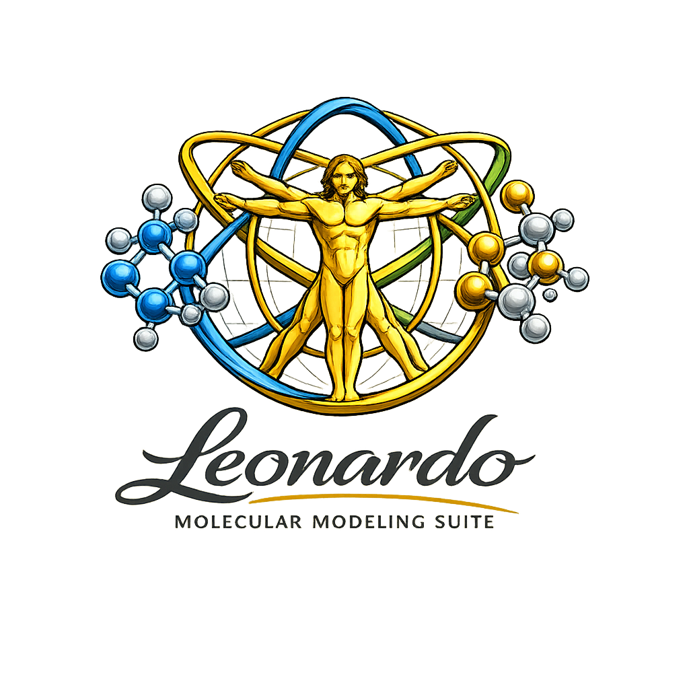
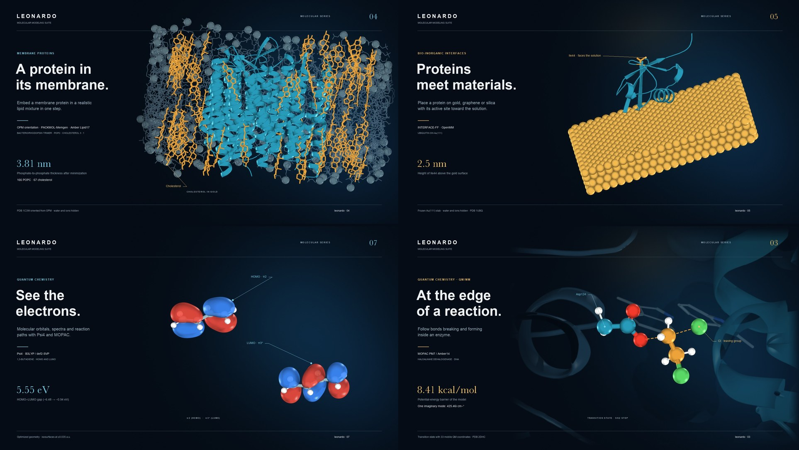
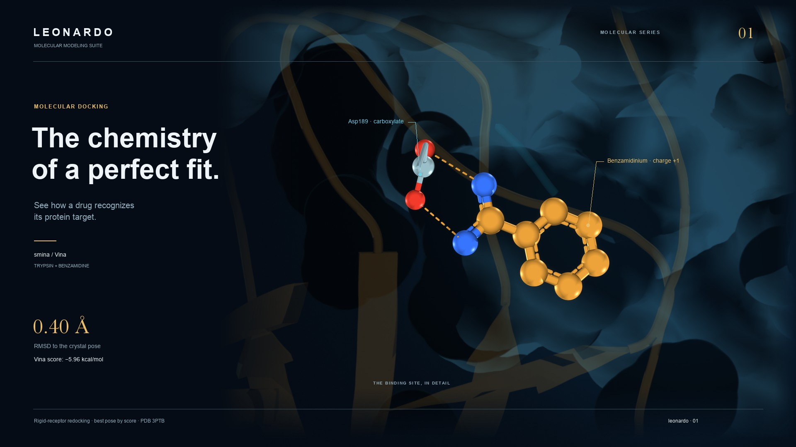
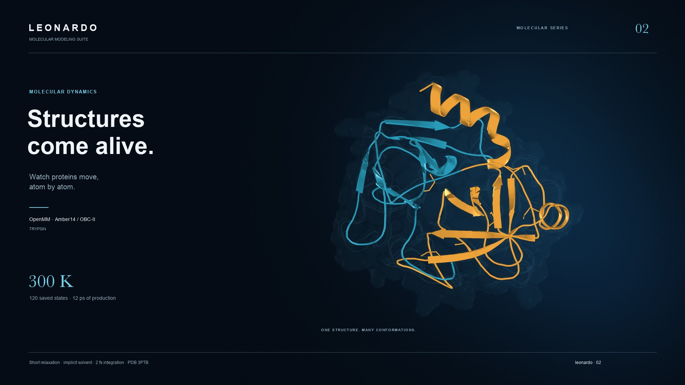
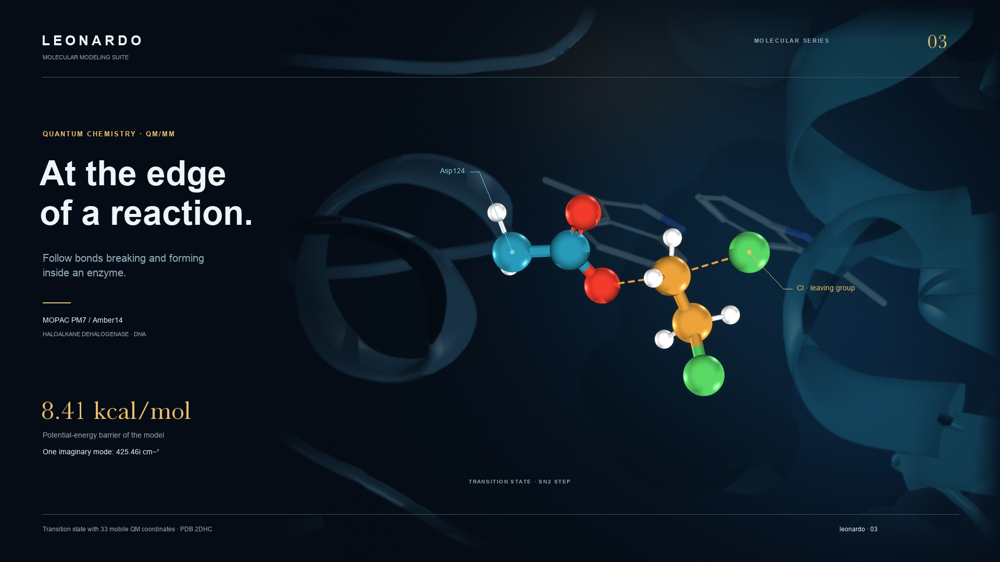
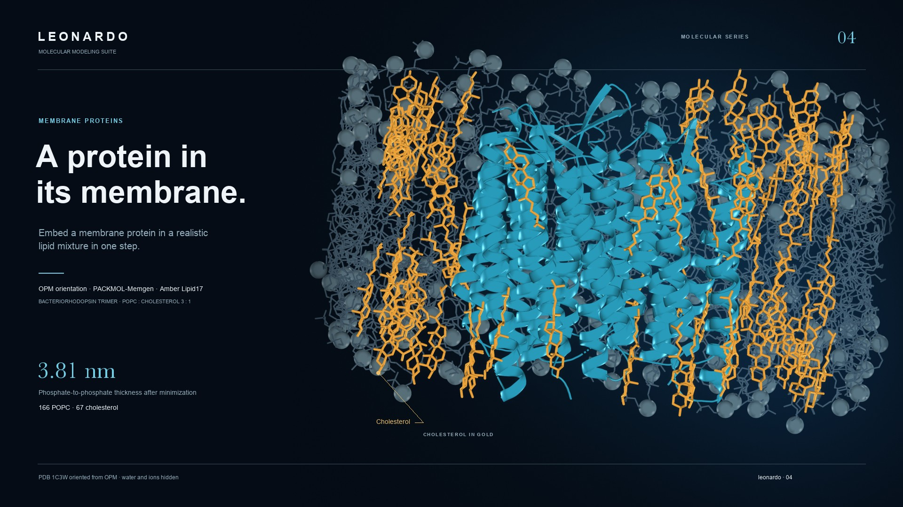
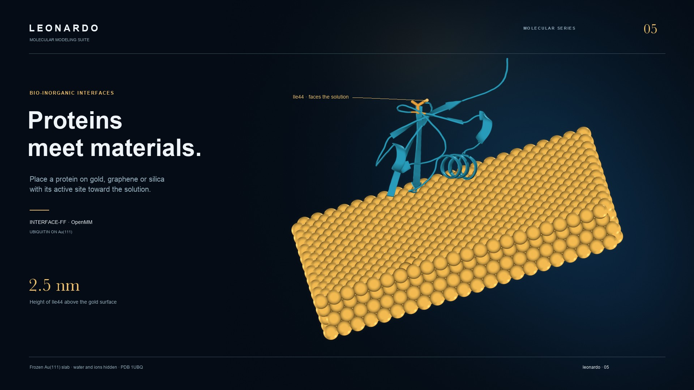
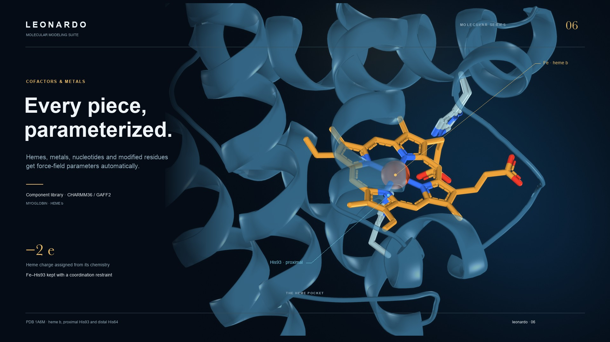
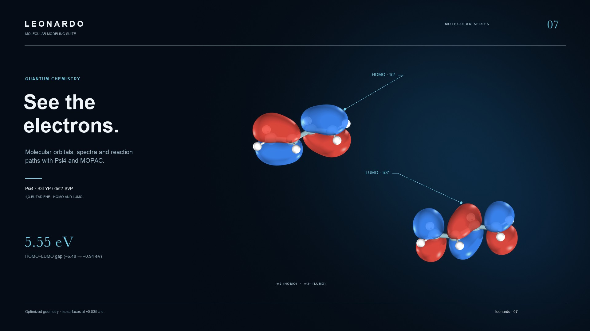
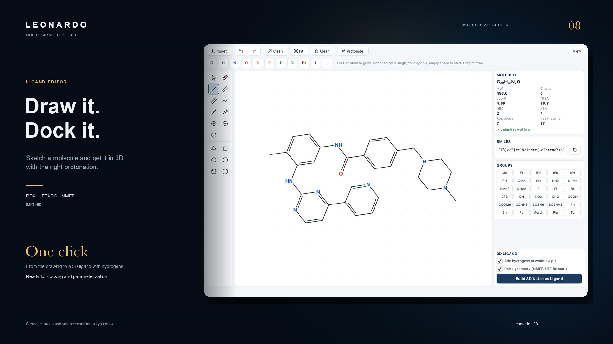

# Leonardo

<p align="center">
  
</p>

<p align="center">
  <b>A molecular modeling studio inside PyMOL, driven by an AI assistant.</b><br>
  Docking · molecular dynamics · membranes · materials · quantum chemistry · QM/MM — in plain English.
</p>

<p align="center">
  
</p>

Current version: **0.2.0a7** (`2026-10-01-r2`) · macOS (Apple Silicon and Intel) and Linux ·
MIT license<br>
Status: **pre-release for testing and manuscript verification**

---

## Why Leonardo

- **Ask, don't script.** Type *"put ubiquitin on a gold surface with Ile44 facing the
  water"*. The AI assistant plans the steps, asks before anything heavy, and shows the
  results in PyMOL.
- **Complex systems that just work.** Cofactors, metals, modified residues, covalent ligands,
  lipid mixtures and inorganic surfaces get their parameters automatically.
- **From drawing to quantum chemistry.** Sketch a molecule, dock it, simulate it, then look at
  its orbitals and reaction paths.
- **One installer.** PyMOL, OpenMM, AmberTools, Psi4, MOPAC, MODELLER and everything else
  are installed for you.

---

## Install in 3 steps

1. **Download** `Leonardo-Installer-<version>.zip` from the
   [Releases page](https://github.com/juvenalyosa/Leonardo/releases) and double-click it to
   unzip it.
2. **Run the installer**
   - **macOS:** double-click **`Install Leonardo (macOS).command`**. The first time, macOS
     asks for confirmation: right-click the file → **Open** → **Open**.
   - **Linux:** open a terminal in the unzipped folder and type
     `bash install-leonardo-linux.sh`.
3. **Wait 20–60 minutes** while it installs everything (about 10 GB). When it asks for a
   **MODELLER license key**, paste yours, or just press Return and add it later.

That's it. Open **Leonardo** from your Desktop or Applications (on Linux, from the
applications menu), then choose **Plugins → Leonardo** inside PyMOL.

> **MODELLER key (free for academics):** register at
> <https://salilab.org/modeller/registration.html>. The key arrives by e-mail. To add it later,
> open the **Leonardo MODELLER License** app.

Full step-by-step guide in English and Spanish: [docs/INSTALL.md](docs/INSTALL.md).

---

## Your first five minutes

1. Open **Leonardo**. PyMOL starts.
2. In PyMOL choose **Plugins → Leonardo**.
3. Click **AI Assistant…**. The first time, open **Settings** and paste an Anthropic (Claude)
   or OpenAI API key. Keys are kept in your system keychain.
4. Type a request, for example:

   ```text
   Download 1UBQ, put it in a water box with 0.15 M NaCl, minimize it and run 20 ps of MD.
   ```

5. Read the plan, click **Approve**, and watch the result appear in PyMOL.

Every module also works without the assistant, from the buttons of the Leonardo window.

---

## What you can build

Each example below runs on a laptop. Copy the text into the **AI Assistant** and press Enter.

### Molecular docking



Find how a ligand binds its protein, score the poses, and measure them against the crystal
structure.

```text
Download 3PTB, take its benzamidine out, dock it back and tell me the RMSD to the crystal pose.
```

*Without the assistant:* **Pocket & Docking…** → **1) Pocket Discovery** → **2) Ligand Source**
→ **3–4) Docking & Poses**.

### Molecular dynamics



Solvate, minimize and simulate with OpenMM, then play the trajectory in PyMOL.

```text
Download 1UBQ, put it in a water box with 0.15 M NaCl, minimize and run 50 ps of MD at 300 K.
```

*Without the assistant:* **OpenMM Dynamics…**

### Reactions inside enzymes (QM/MM)



Treat the reacting atoms with quantum chemistry (MOPAC) and the rest of the enzyme
classically, then find the transition state.

```text
Download 1HRC and propose a QM region around the heme c. Then run a QM/MM single point.
```

*Without the assistant:* **QM/MM (MOPAC)…**

### Membrane proteins in lipid mixtures



Orient a membrane protein (OPM database or predicted helices) and embed it in a single lipid
or a realistic mixture: POPC:cholesterol, bacterial POPE:POPG, or a different composition in
each leaflet.

```text
Download 1C3W, orient it with OPM and embed it in a POPC:cholesterol 3:1 membrane.
```

### Proteins on materials



Place a protein on gold, silver, platinum, graphene or hydroxylated silica, with a chosen site
facing the solution. This is the starting point for biosensor design.

```text
Put 1UBQ on a gold Au(111) surface with Ile44 facing the solution.
Put 1UBQ on silica with Ile44 facing the solution.
```

### Cofactors, metals and modified residues



Hemes, NAD, ATP, zinc sites, phosphorylated residues, ligands bound to Cys or Lys (such as
retinal): Leonardo finds parameters for each component, or sends it to QM/MM when no
classical model exists.

```text
Download 1A6M and tell me where the parameters of every component come from.
Download 3KS3, check the zinc site and build a validated system.
```

### Molecular orbitals and reactions



Optimize molecules, look at their orbitals, IR and UV spectra and electrostatic surfaces, and
follow a reaction from transition state to products.

```text
Build 1,3-butadiene from the SMILES C=CC=C, optimize it with MOPAC and show the HOMO and LUMO.
Build HCN, find the transition state of HCN -> HNC with hf/3-21G and animate the reaction with the HOMO.
```

### Draw your own molecules



A full 2D editor with rings, functional groups, stereochemistry and charges. One click turns
the drawing into a 3D ligand with hydrogens at your pH.

```text
Open the ligand editor, draw aspirin and build it in 3D at pH 7.4.
```

*Without the assistant:* **Ligand Editor…**

---

## More ideas to try

| You want to… | Type this |
|---|---|
| Check a structure before simulating it | `Download 2GS2 and run a diagnostics check.` |
| Model a mutant (needs MODELLER) | `Mutate Ile44 of 1UBQ to Ala and build the model.` |
| Redock a kinase inhibitor | `Download 1IEP, redock imatinib and show its hydrogen bonds.` |
| Bacterial membrane | `Embed 1AFO in a POPE:POPG 3:1 membrane.` |
| Graphene sensor | `Put 1UBQ on graphene with Ile44 facing the solution.` |
| Infrared spectrum | `Optimize formaldehyde with MOPAC, show the IR spectrum and animate the C=O stretch.` |
| Diels–Alder reaction | `Build cyclohexene and compute the retro-Diels–Alder path with hf/3-21G; animate it with the HOMO.` |

Tip: start small (single proteins, short simulations), and ask for more once a run works.

---

## Requirements

- macOS (Apple Silicon or Intel), or Linux x86_64 with a desktop.
- About 10 GB of free disk and an internet connection for the installation.
- An NVIDIA GPU is optional; everything runs on the CPU.
- For the AI assistant: an Anthropic or OpenAI API key.

---

<details>
<summary><b>For developers</b></summary>

### Install from a clone

The repository is private, so authenticate with GitHub first, then clone it and run the same
installer on your working copy. It installs Miniforge if no conda is found:

```bash
git clone https://github.com/juvenalyosa/Leonardo.git
cd Leonardo
bash installers/install_leonardo.sh
```

The previous developer workflow (editable install, smoke tests and `dist/Leonardo.zip`) is
still available: `./scripts/install_leonardo.sh` (add `--with-optional` for local ColabFold,
or `--recreate` to start over). Launch with `./scripts/launch_leonardo.sh`.

### Validate

```bash
conda activate protliginteract-full
leonardo-readiness --strict
make lint
PYTEST_DISABLE_PLUGIN_AUTOLOAD=1 python -m pytest -q
```

### Build the release artifacts

```bash
./scripts/build_leonardo_zip.sh          # PyMOL plugin (Plugin Manager → Install New Plugin)
./scripts/build_installer_bundle.sh      # Leonardo-Installer-<version>.zip for end users
python docs/gallery/make_gallery.py --work <dir>   # README posters
```

### Repository layout

```text
Leonardo/
├── src/leonardo/        Canonical runtime package (and the AI assistant in agent/)
├── legacy/              PyMOL UI and historical import compatibility
├── packaging/pymol/     PyMOL plugin entry point
├── assets/              UI, images and bundled JSME files
├── tests/               Automated test suite
├── benchmarks/          Scientific fixtures and validation workflows
├── examples/            Small input files and runnable examples
├── environments/        Conda specifications and lockfile
├── scripts/             Build, install, launch and maintenance commands
├── installers/          End-user installer and platform shortcuts
├── docs/                Installation guide, gallery and maintainer documentation
├── draft/               Manuscript and generated validation artifacts
└── dist/                Reproducible PyMOL release archive
```

See [Repository layout](docs/REPOSITORY_LAYOUT.md) and [Architecture](docs/ARCHITECTURE.md).

</details>

---

## Scientific and licensing notes

Leonardo orchestrates established scientific engines; it does not replace method-specific
validation. Results depend on inputs, protonation states, force fields, sampling, engine
versions and convergence criteria.

Third-party engines may have separate licenses or usage restrictions (MODELLER needs a free
academic license). See [Third-party licenses](THIRD_PARTY_LICENSES.md).

Citation metadata is in [CITATION.cff](CITATION.cff). Leonardo is distributed under the
[MIT License](LICENSE).

Author: Juvenal Yosa, PhD · Support and bug reports: `thinkai.col@gmail.com`
