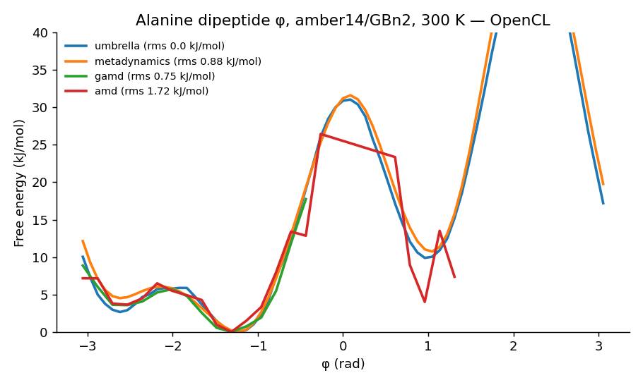

# Enhanced sampling and machine-learned potentials

Leonardo runs four enhanced-sampling methods and OpenMM-ML dynamics on the real system (the object in PyMOL,
with its ligands and cofactors parameterized by the component library), on the GPU OpenMM picks. Ask the
assistant (`run_enhanced_sampling` with `action: run`) or use **OpenMM → Advanced Methods** in the Leonardo
window: choose the workflow, fill in the parameters, and answer **Yes** to "Run now?". Runs go in the
background; the result opens with its plot, and every file (CSV data, PNG plots, the job and the template) is
in the run's folder.

| Method | What it does | Analysis and plots |
|---|---|---|
| Umbrella sampling | Harmonic windows along one collective variable (CV); all windows share one GPU context, swept outward from the starting value | PMF by MBAR (pymbar) with uncertainties, window histograms, neighbour overlap |
| Metadynamics | Well-tempered metadynamics on 1-3 CVs (OpenMM `Metadynamics`, bias grid on the GPU) | Free-energy profile or surface, CV traces, surfaces at 50/75/100 % of the run |
| aMD | Dual-boost accelerated MD (Hamelberg 2004); thresholds from a short conventional MD with the Pierce et al. 2012 rules | PMF along the CVs reweighted (2nd-order cumulant and exponential), boost distribution |
| GaMD | Dual-boost Gaussian accelerated MD (Miao et al. 2015), lower-bound threshold, σ0 = 6 kcal/mol by default | Same as aMD, with the anharmonicity of the boost |
| OpenMM-ML | MD with ANI-2x (or ANI-1ccx) for a whole small molecule, or for a ligand inside the classical system (mixed ML/MM) | Energy, temperature and ML-region RMSD over time |

Collective variables: distance, angle and dihedral between atom-group centroids, and RMSD from the start, from
Leonardo's presets (protein-ligand distance, ligand unbinding, backbone RMSD, loop gate, reaction bond or angle,
torsion, metal coordination) or your own PyMOL selections. Selections are mapped to the prepared system by
chain, residue number, insertion code and atom name (heavy atoms); a selection that does not map stops the run.

## How it runs on the GPU

There is no hand-written CUDA: OpenMM compiles the custom forces and integrators into GPU kernels for CUDA,
HIP and OpenCL. The CV is a `CustomCentroidBondForce` (or `RMSDForce`), the umbrella restraint a
`CustomCVForce` whose centre and spring constant are context parameters, metadynamics OpenMM's own class, and
aMD/GaMD a Langevin `CustomIntegrator` with the boost in its force term (OpenMM's built-in aMD integrators are
NVE). The boosted force, f* = f (1 + dΔV_total/dV) + f_dihedral dΔV_dihedral/dV_dihedral, is checked against
finite differences of the boosted potential in the test suite. Each result reports the platform and precision it
ran on (NVIDIA/AMD: mixed precision; Apple GPUs: single).

OpenMM-ML runs in a separate environment, `leonardo-ml` (openmm-ml, openmm-torch, TorchANI), because PyTorch
conflicts with the main one; the installer creates it and downloads the ANI-2x weights from TorchANI's
repository (`~/.local/share/Torchani`). The network runs through openmm-torch on CUDA GPUs, or on the CPU
(openmm-torch has no OpenCL/Metal kernels). ANI covers H, C, N, O, F, S and Cl and was trained on neutral
molecules: Leonardo refuses a charged ML region (a benzamidinium test came apart).

## Validation

Alanine dipeptide, φ torsion, amber14 + GBn2, 300 K, on an Apple M4 GPU (OpenCL, single precision):
`python scripts/enhanced_sampling_validation.py OUT`.

| Method | Length | RMS difference from umbrella (sampled region) | Minimum |
|---|---|---|---|
| Umbrella sampling (MBAR) | 24 windows x 20 ps | — | φ = -1.22 rad |
| Metadynamics | 1 ns | 0.9 kJ/mol | -1.22 rad |
| GaMD | 1 ns | 0.8 kJ/mol | -1.31 rad |
| aMD | 1 ns | 1.7 kJ/mol | -1.31 rad |

Umbrella sampling and metadynamics agree along all of φ, including the barrier near φ = 0 (about 31 kJ/mol) and
the αL basin near φ = +1 rad. GaMD and aMD agree where they sampled; in 1 ns they reach αL rarely, and the
reweighted profile there is noisy. The `examples/enhanced_sampling` replay pack runs every method through the
assistant's tool, and `examples/gpu_validation` checks that each one ran on a GPU.

## Reading the results

Short runs give qualitative profiles. Each result carries its diagnostics, and the assistant reports them:
- umbrella: neighbour histogram overlap (a warning below 0.05: add windows or lower the spring);
- metadynamics: the hills deposited and how much the profile changed over the last quarter of the run;
- aMD/GaMD: boost mean and SD, and the anharmonicity γ of the boost distribution (above 0.01 the cumulant
  reweighting is approximate; ΔV fluctuations above ~3 kT make it noisy);
- OpenMM-ML: temperature and the RMSD of the ML region (a region that falls apart is not stable with that model).

## Not in this version

Alchemical binding free energies (FEP, thermodynamic integration); GaMD with the parameters updated during its
equilibration (Leonardo takes them from the conventional MD); replica exchange.

## References

- Torrie & Valleau, J. Comput. Phys. 23, 187 (1977); Shirts & Chodera, J. Chem. Phys. 129, 124105 (2008) (MBAR).
- Barducci, Bussi & Parrinello, Phys. Rev. Lett. 100, 020603 (2008) (well-tempered metadynamics).
- Hamelberg, Mongan & McCammon, J. Chem. Phys. 120, 11919 (2004); Pierce et al., J. Chem. Theory Comput. 8,
  2997 (2012) (aMD).
- Miao, Feher & McCammon, J. Chem. Theory Comput. 11, 3584 (2015) (GaMD).
- Devereux et al., J. Chem. Theory Comput. 16, 4192 (2020) (ANI-2x); Eastman et al., J. Phys. Chem. B 128, 109
  (2024) (OpenMM 8 and OpenMM-ML).
